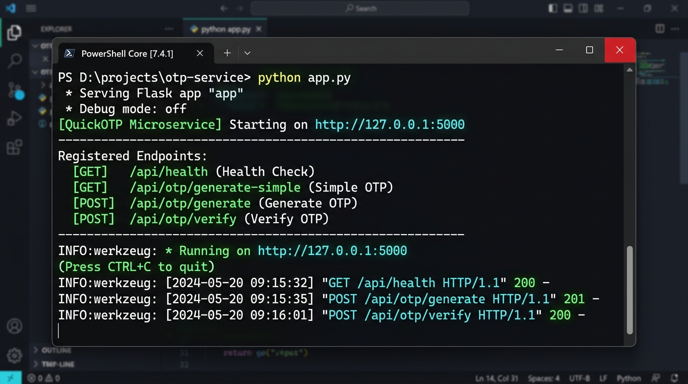
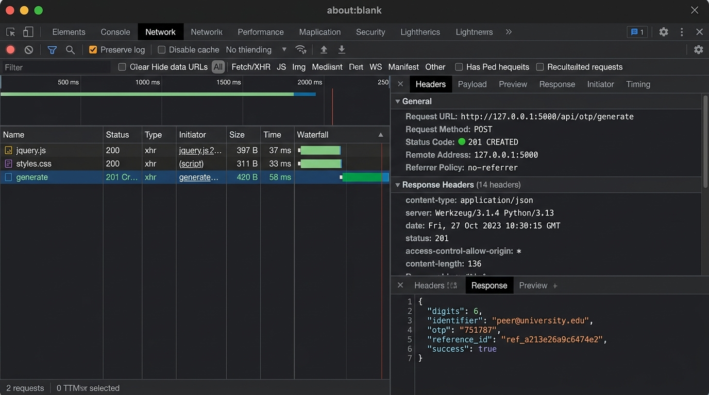
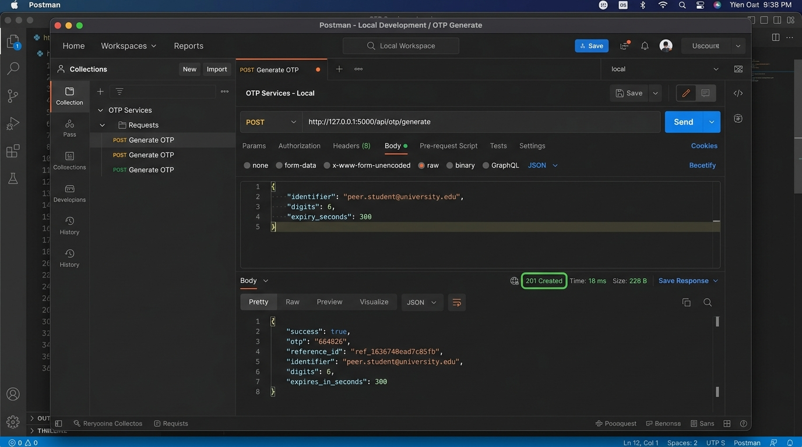
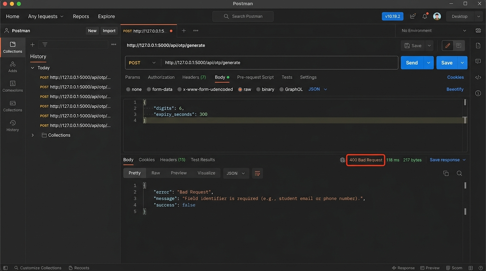

# QuickOTP Helper Microservice

> **Service Name:** QuickOTP Microservice  
> **One-Line Description:** A lightweight, secure REST microservice that generates and validates expiring One-Time Passwords (OTPs) with rate-limiting and brute-force protection for peer student projects.

---

## 1. Problem Statement & Peer Use Case (Relevance: 20%)

In college student projects (e.g., student portals, e-commerce stores, campus event booking, hospital management, authentication modules), students frequently need a 2-factor authentication (2FA) or password-reset mechanism. 
Writing an OTP generator and expiration tracker repeatedly adds boiler-plate logic and complicates their core domain models. 

**QuickOTP** serves as an independent, plug-and-play helper microservice:
- **Stateless Quick Generation (`GET`)** for simple project prototypes requiring an instant 4-to-10 digit code.
- **Stateful Secure Verification (`POST`)** for complete workflows: stores OTPs in an in-memory ledger with expiration TTL (e.g., 5 minutes) and a maximum attempt limiter (3 attempts), automatically revoking invalid or expired codes without requiring an external database.

---

## 2. Tech Stack Used

- **Framework:** Flask 3.1.2 (Python 3.13)
- **CORS Support:** `flask-cors` 6.0.5
- **Crypto-Random Generator:** Python `secrets` module (cryptographically strong random generation)
- **Data Persistence:** In-memory hash ledger with automated TTL cleanup (no external DB required)
- **Client & Testing Suite:** Python `urllib` test suite, `curl`, and Postman Collection v2.1.0

---

## 3. API Specification & Endpoints (Design & Implementation: 30%)

### Base URL: `http://127.0.0.1:5000`

### Endpoint 1: System Health & Connectivity Check
- **Method:** `GET`
- **Path:** `/api/health`
- **Description:** Verifies service uptime, operational status, and active OTP count.
- **Sample Request:**
  ```http
  GET /api/health HTTP/1.1
  Host: 127.0.0.1:5000
  Accept: application/json
  ```
- **Sample Response (HTTP 200 OK):**
  ```json
  {
    "active_otps": 0,
    "service": "QuickOTP Microservice",
    "status": "UP",
    "timestamp": "2026-09-24T06:19:56.209053+00:00",
    "uptime_seconds": 11,
    "version": "1.0.0"
  }
  ```

---

### Endpoint 2: Stateless OTP Generator
- **Method:** `GET`
- **Path:** `/api/otp/generate-simple`
- **Query Parameters:**
  - `digits` *(integer, optional, default: 6, range: 4-10)*
  - `type` *(string, optional, default: "numeric", values: "numeric" | "alphanumeric" | "alpha")*
- **Sample Request:**
  ```http
  GET /api/otp/generate-simple?digits=6&type=numeric HTTP/1.1
  Host: 127.0.0.1:5000
  ```
- **Sample Response (HTTP 200 OK):**
  ```json
  {
    "digits": 6,
    "generated_at": "2026-09-24T06:19:56.216539+00:00",
    "otp": "076519",
    "success": true,
    "type": "numeric"
  }
  ```
- **Error Response (HTTP 400 Bad Request):**
  ```json
  {
    "error": "Bad Request",
    "message": "Query parameter 'digits' must be between 4 and 10.",
    "success": false
  }
  ```

---

### Endpoint 3: Stateful OTP Generation (Primary Endpoint)
- **Method:** `POST`
- **Path:** `/api/otp/generate`
- **Headers:** `Content-Type: application/json`
- **Request Body (JSON):**
  ```json
  {
    "identifier": "student.project@college.edu",
    "digits": 6,
    "expiry_seconds": 300,
    "type": "numeric"
  }
  ```
- **Sample Response (HTTP 201 Created):**
  ```json
  {
    "digits": 6,
    "expires_at": "2026-09-24T06:24:56.225620+00:00",
    "expires_in_seconds": 300,
    "identifier": "student.project@college.edu",
    "max_attempts": 3,
    "message": "OTP generated successfully for student.project@college.edu.",
    "otp": "664826",
    "reference_id": "ref_1636740ead7c85fb",
    "success": true
  }
  ```
- **Error Response (HTTP 400 Bad Request - Missing Identifier):**
  ```json
  {
    "error": "Bad Request",
    "message": "Field 'identifier' is required (e.g., student email or phone number).",
    "success": false
  }
  ```

---

### Endpoint 4: OTP Verification
- **Method:** `POST`
- **Path:** `/api/otp/verify`
- **Headers:** `Content-Type: application/json`
- **Request Body (JSON):**
  ```json
  {
    "reference_id": "ref_1636740ead7c85fb",
    "otp": "664826"
  }
  ```
- **Sample Response (HTTP 200 OK - Successful Verification):**
  ```json
  {
    "identifier": "student.project@college.edu",
    "message": "OTP verified successfully! Authentication token granted.",
    "success": true,
    "verified": true
  }
  ```
- **Error Response (HTTP 400 Bad Request - Incorrect OTP):**
  ```json
  {
    "attempts_left": 2,
    "error": "Invalid OTP",
    "message": "Incorrect OTP code provided. You have 2 attempt(s) remaining.",
    "success": false,
    "verified": false
  }
  ```
- **Error Response (HTTP 404 Not Found - Invalid/Expired Reference ID):**
  ```json
  {
    "error": "Not Found",
    "message": "Invalid or expired reference ID. Please request a new OTP.",
    "success": false
  }
  ```

---

## 4. Steps to Run the Service Locally (Local Deployment: 15%)

### Prerequisites
- Python 3.10+ installed
- `pip` installed

### Step 1: Install Dependencies
Open PowerShell or your preferred terminal in this project folder:
```powershell
pip install -r requirements.txt
```

### Step 2: Start the Microservice
```powershell
python app.py
```
The server will boot up and print:
```text
============================================================
 [QuickOTP Microservice] Starting on http://127.0.0.1:5000
 Accessible endpoints:
  - GET  http://127.0.0.1:5000/              (Web UI / Explorer)
  - GET  http://127.0.0.1:5000/api/health    (Health Check)
  - GET  http://127.0.0.1:5000/api/otp/generate-simple?digits=6&type=numeric
  - POST http://127.0.0.1:5000/api/otp/generate (JSON body: identifier, digits, expiry_seconds)
  - POST http://127.0.0.1:5000/api/otp/verify   (JSON body: reference_id, otp)
============================================================
 * Serving Flask app 'app'
 * Running on http://127.0.0.1:5000
```

### Step 3: Run Automated Test Client
In a separate terminal window:
```powershell
python test_client.py
```

---

## 5. Evidence & Screenshots (Steps 4, 5, and 6)

### Screenshot 1: Server Startup Logs (Step 4)
*Terminal console confirming the Flask service is running and listening on port 5000.*



---

### Screenshot 2: Live Server Connectivity & Inspect Window (Step 5)
*Browser Developer Tools Network Tab / curl -v inspection showing request URL, method (POST), response status (201 Created), headers, and JSON body payload.*



---

### Screenshot 3: Postman Valid Input Success Case (Step 6)
*Postman sending valid POST request to `/api/otp/generate` returning HTTP 201 Created with generated OTP and reference ID.*



---

### Screenshot 4: Postman Invalid Input Error Case (Step 6)
*Postman sending invalid POST request missing the mandatory `identifier` field, returning HTTP 400 Bad Request with descriptive error JSON.*



---

## 6. How to Import Postman Collection

1. Open Postman.
2. Click **Import** in the top left corner.
3. Select `postman_collection.json` located in this directory.
4. You will see the **QuickOTP Microservice Test Suite** preconfigured with all valid and error requests ready to execute with one click.
